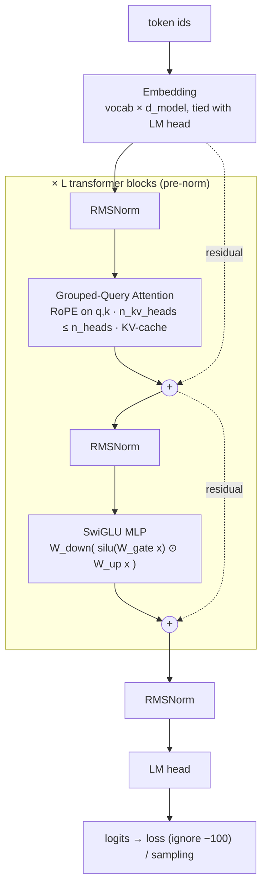

# scratchformer

**Every piece of a modern LLM — tokenizer, RoPE, GQA, KV-cache, LoRA, speculative decoding, trainer — written from the math, tested for equivalence, and small enough to train on a laptop.**

  

A decoder-only transformer in plain PyTorch with no modelling dependencies: byte-level BPE, rotary
embeddings, RMSNorm, SwiGLU, grouped-query attention, a pre-allocated KV-cache, LoRA adapters,
speculative decoding, a deterministic trainer with exact resume, and an `argparse` CLI. The whole
thing runs on CPU; the demo model has 789k parameters and learns to reverse digit strings to
99.9 % token accuracy in 600 steps (about two minutes on two cores).

## What makes this expert-level

- **Equivalence tests, not snapshot tests.** KV-cached decoding equals the full forward pass
  (atol 1e-4); SDPA equals a hand-written masked softmax; GQA with expanded weights equals MHA;
  a merged LoRA adapter equals the unmerged model; speculative greedy output is byte-identical to
  plain greedy; resumed training is bit-identical to uninterrupted training (dropout included).
- **Speculative decoding done properly.** The Leviathan/Chen acceptance rule
  (accept with prob `min(1, p/q)`, resample from `norm(max(0, p − q))`, bonus token on full
  acceptance) is a pure function whose output distribution is checked against the target
  distribution with 20k synthetic draws. Both models keep KV-caches; rollback is a pointer move.
- **Positions are explicit everywhere.** RoPE takes absolute positions, the cache owns the
  pointer, and chunked decoding with a non-zero offset (needed by speculative catch-up steps) is
  handled by one offset-aware mask — no `torch.cat` on every step, no position bookkeeping in
  callers.
- **Deterministic training with real checkpoints.** The trainer saves model, optimiser, step,
  configs and *both* RNG streams (data sampler and dropout), loads with
  `torch.load(weights_only=True)`, logs JSONL metrics and supports callbacks.
- **A tokenizer you can read.** Byte-level BPE with incremental pair counts, deterministic tie
  breaking, a documented original pre-tokenizer regex, and exact UTF-8 round-trips for accents,
  emoji and CJK, checked against a naive textbook implementation.

## Quickstart

```bash
pip install -e ".[dev]"                       # torch (CPU is fine) + numpy; pytest + ruff for dev
pytest -q                                     # 149 tests, ~8 s on two CPU cores
scratchformer summary --preset nano
scratchformer train --task reverse --preset nano --steps 600 --out runs/reverse
scratchformer eval-task --ckpt runs/reverse/ckpt.pt --task reverse
scratchformer generate --ckpt runs/reverse/ckpt.pt --prompt-tokens "3 1 4 1 5 9 2 6" --speculative
```

`make demo` runs the full walk-through below (about eight minutes on two cores); `make test-all`
includes the slow end-to-end training test.

## Architecture



`Transformer.forward(idx, targets=None, cache=None, start_pos=0)` returns `(logits, loss)`. With a
`KVCache` the model appends new keys/values, derives absolute RoPE positions from the cache pointer,
and advances it; without one it is an ordinary causal forward pass. Three presets are provided:

| preset | d_model | layers | heads / kv heads | params (vocab 12) | use |
| --- | --- | --- | --- | --- | --- |
| `test` | 32 | 2 | 2 / 1 | 31,264 | unit tests, draft models |
| `nano` | 128 | 4 | 4 / 2 | 789,120 | the CPU demo |
| `small` | 384 | 6 | 6 / 3 | ~9.9M (vocab 512) | real text on a GPU |

Package layout: `tokenizer/` (BPE, pre-tokenizer), `model/` (norm, rope, attention, mlp, block,
transformer, cache, lora, utils), `data/` (synthetic tasks, text datasets), `train/` (optimizer,
checkpoint, trainer), `inference/` (sampling, generate, speculative), `cli.py`. A file-by-file map
and the design decisions live in [docs/ARCHITECTURE.md](docs/ARCHITECTURE.md).

## Feature walk-through

All outputs below are pasted from real runs on a 2-core CPU sandbox (PyTorch 2.14, no GPU).
Timings vary by ±20 % between runs on this machine; accuracies are exactly reproducible given the
seed.

### 1. Model summary: parameters, FLOPs/token, memory

```text
$ scratchformer summary --preset nano
scratchformer model summary
  d_model=128  n_layers=4  n_heads=4  n_kv_heads=2  head_dim=32  mlp_hidden=384
  vocab_size=512  max_seq_len=256  tie_embeddings=True  attention=sdpa
  parameters          : 853,120 (853.12K)
  non-embedding params: 787,584 (787.58K)
  instantiated params : 853,120 (trainable 853,120)
  FLOPs/token forward : 2,228,224 (2.23M) at seq_len=256, attention share 23.5%
  FLOPs/token train   : 6,684,672 (6.68M)
  memory: weights fp32 3.4 MB; training state (w+g+Adam) 13.6 MB
  KV-cache: 2,048 B/token/sequence -> 524.3 KB for one sequence of 256 tokens
```

The parameter count comes from a closed-form formula (`analytic_param_count`) that the tests
check against the instantiated model for every preset, tied and untied.

### 2. Train on a synthetic task (ReverseTask, nano, 600 steps)

ReverseTask prompts are 4–16 random digits followed by a separator; the model must emit the digits
reversed and then a PAD end marker. Only answer positions are scored (prompt targets are `-100`).

```text
$ scratchformer train --task reverse --preset nano --steps 600 --out runs/reverse
task ReverseTask(min_len=4, max_len=16) | seq_len 34 | preset nano
model: 789,120 parameters
step    50 | loss 1.9545 | lr 1.96e-03 | grad_norm 1.761 | 12491 tok/s
step   100 | loss 1.3023 | lr 1.96e-03 | grad_norm 4.089 | 12205 tok/s
eval   100 | val_loss 1.2248 | accuracy 0.5787
step   150 | loss 0.9009 | lr 1.86e-03 | grad_norm 6.176 | 14525 tok/s
step   200 | loss 0.6380 | lr 1.69e-03 | grad_norm 6.379 | 11990 tok/s
eval   200 | val_loss 0.5683 | accuracy 0.8092
step   250 | loss 0.3906 | lr 1.48e-03 | grad_norm 7.279 | 13811 tok/s
step   300 | loss 0.2616 | lr 1.23e-03 | grad_norm 7.448 | 15969 tok/s
eval   300 | val_loss 0.2097 | accuracy 0.9282
step   350 | loss 0.1324 | lr 9.77e-04 | grad_norm 6.921 | 12259 tok/s
step   400 | loss 0.0228 | lr 7.31e-04 | grad_norm 1.476 | 14500 tok/s
eval   400 | val_loss 0.0331 | accuracy 0.9920
step   450 | loss 0.0199 | lr 5.15e-04 | grad_norm 1.651 | 9373 tok/s
step   500 | loss 0.0062 | lr 3.46e-04 | grad_norm 1.170 | 8843 tok/s
eval   500 | val_loss 0.0133 | accuracy 0.9964
step   550 | loss 0.0158 | lr 2.38e-04 | grad_norm 1.532 | 13794 tok/s
step   600 | loss 0.0035 | lr 2.00e-04 | grad_norm 0.719 | 13729 tok/s
eval   600 | val_loss 0.0037 | accuracy 0.9991
saved checkpoint to runs/reverse/ckpt.pt (step 600)
training finished: 600 steps in 132.5s
result: 600 steps in 132.5s | final loss 0.0035 | val_loss 0.0037 | accuracy 0.9991
checkpoint: runs/reverse/ckpt.pt
```

98 % token accuracy is crossed between steps 350 and 400; the run above took 132 s wall-clock
(a repeat of the same configuration, evaluating every 50 steps, took 118 s and produced the same
accuracies). Metrics are also written to `runs/reverse/metrics.jsonl`,
and `--resume` continues from `runs/reverse/ckpt.pt` with bit-identical results.

### 3. Evaluate: teacher-forced token accuracy and generated exact match

```text
$ scratchformer eval-task --ckpt runs/reverse/ckpt.pt --task reverse
checkpoint runs/reverse/ckpt.pt (step 600) on ReverseTask(min_len=4, max_len=16)
token accuracy     : 0.9996  (20 x 64 examples, teacher-forced)
exact-match (greedy): 0.9800  (200 prompts, generated to PAD)
evaluated in 2.2s
  ok  3 9 9 6 7 7 | -> 7 7 6 9 9 3
  ok  2 1 5 6 6 0 9 6 4 1 4 | -> 4 1 4 6 9 0 6 6 5 1 2
  ok  5 2 3 4 4 0 3 9 6 6 9 5 | -> 5 9 6 6 9 3 0 4 4 3 2 5
  ok  0 4 5 8 0 7 7 | -> 7 7 0 8 5 4 0
  ok  9 5 6 1 2 5 7 6 9 6 3 6 | -> 6 3 6 9 6 7 5 2 1 6 5 9
```

Exact match is the stricter metric: the model must generate every digit *and* the end marker
without teacher forcing. 196 of 200 random prompts come back perfect.

### 4. Generate, with and without speculative decoding

Plain cached greedy decoding (prefill + one forward per token):

```text
$ scratchformer generate --ckpt runs/reverse/ckpt.pt --prompt-tokens "3 1 4 1 5 9 2 6"
prompt  : 3 1 4 1 5 9 2 6 |
output  : 6 2 9 5 1 4 1 3
9 tokens in 27 ms
expected: 6 2 9 5 1 4 1 3  -> correct
```

`--speculative` without a draft uses the target as its own draft. That is the correctness check
from the paper (acceptance must be exactly 1.0), and the CLI says so rather than pretending it is a
speed-up:

```text
$ scratchformer generate --ckpt runs/reverse/ckpt.pt --prompt-tokens "3 1 4 1 5 9 2 6" --speculative
prompt  : 3 1 4 1 5 9 2 6 |
draft   : (none given) using the target as its own draft -> acceptance is 1.0 by construction
output  : 6 2 9 5 1 4 1 3
speculative: k=4 | 9 tokens in 2 rounds | acceptance rate 1.000 (7/7) | 4.50 tokens per target forward | 24 ms
greedy check: identical to plain greedy decoding (plain: 19 ms)
expected: 6 2 9 5 1 4 1 3  -> correct
```

For a real draft, train the 31k-parameter `test` preset on the same task (25× smaller than the
target; 2000 steps take 71 s and reach 98.2 % token accuracy):

```text
$ scratchformer train --task reverse --preset test --steps 2000 --lr 3e-3 --out runs/reverse-draft
$ scratchformer generate --ckpt runs/reverse/ckpt.pt --prompt-tokens "3 1 4 1 5 9 2 6" \
      --speculative --draft-ckpt runs/reverse-draft/ckpt.pt
prompt  : 3 1 4 1 5 9 2 6 |
draft   : runs/reverse-draft/ckpt.pt (31,264 params)
output  : 6 2 9 5 1 4 1 3
speculative: k=4 | 9 tokens in 2 rounds | acceptance rate 1.000 (7/7) | 4.50 tokens per target forward | 16 ms
greedy check: identical to plain greedy decoding (plain: 23 ms)
expected: 6 2 9 5 1 4 1 3  -> correct
```

One prompt is a small sample; `examples/speculative_demo.py` runs 100 random prompts both ways:

```text
$ python examples/speculative_demo.py --target runs/reverse/ckpt.pt --draft runs/reverse-draft/ckpt.pt --prompts 100 --k 4
target runs/reverse/ckpt.pt  draft runs/reverse-draft/ckpt.pt  task ReverseTask(min_len=4, max_len=16)  k=4
prompts: 100  new tokens: 1039
acceptance rate: 0.961 (783/815)
tokens per target forward: 4.06 (plain decoding = 1.00)
wall time: speculative 1.93s vs plain 2.70s (speed-up x1.40)
greedy outputs identical for 100/100 prompts
```

With a weaker draft (same preset, 600 steps, 66 % token accuracy) the acceptance rate drops to
0.404 and the wall-clock speed-up disappears (0.78×) even though target forwards still fall by
2.24×: at this scale a draft forward costs almost as much as a target forward on CPU, so the draft
has to be *good*, not just small. Both outputs stayed identical to plain greedy for 100/100 prompts.

### 5. LoRA: adapt the reverse model to sorting with 1.78 % of the weights

```text
$ scratchformer lora --ckpt runs/reverse/ckpt.pt --task sort --steps 300 --out runs/lora-sort
base checkpoint runs/reverse/ckpt.pt (trained on reverse) on SortTask(min_len=4, max_len=16):
  before LoRA: accuracy 0.1956 | val_loss 6.5594
LoRA r=8 alpha=16.0 targets=wq,wv: 14,336 trainable / 803,456 total = 1.78%
step    50 | loss 1.7608 | lr 1.95e-03 | grad_norm 1.284 | 17830 tok/s
step   100 | loss 0.9124 | lr 1.67e-03 | grad_norm 1.867 | 16167 tok/s
eval   100 | val_loss 0.9343 | accuracy 0.6583
step   150 | loss 0.6957 | lr 1.21e-03 | grad_norm 2.514 | 13208 tok/s
step   200 | loss 0.6352 | lr 7.19e-04 | grad_norm 1.776 | 12514 tok/s
eval   200 | val_loss 0.5940 | accuracy 0.7928
step   250 | loss 0.5859 | lr 3.43e-04 | grad_norm 3.340 | 19232 tok/s
step   300 | loss 0.4580 | lr 2.00e-04 | grad_norm 1.845 | 16411 tok/s
eval   300 | val_loss 0.4883 | accuracy 0.8374
training finished: 300 steps in 45.0s
  after LoRA : accuracy 0.8374 | val_loss 0.4883 (300 steps in 45.0s)
adapter saved to runs/lora-sort/adapter.pt (61.2 KB); merged model saved to runs/lora-sort/ckpt.pt
merged-vs-adapter max |logit diff| = 2.36e-05 (max |logit| 8.9, relative 2.6e-06)
```

Only the rank-8 `A`/`B` matrices on `wq` and `wv` are trained (14,336 numbers, a 61 KB adapter);
the frozen base is untouched and the adapter folds back into plain `nn.Linear` weights. Attention-only
adapters at 1.78 % get the sort task from chance (19.6 %) to 83.7 % token accuracy in 300 steps;
adapting every projection (`--targets all`, 8.98 % trainable) reaches 98.7 % token accuracy and
86 % exact match in the same 300 steps (67 s). Sorting is a harder algorithm than reversal, and the
table below reports both honestly. Re-running the command reproduces every number above except the
wall time (59.6 s on the repeat), which is the determinism contract at work.

### 6. Real text: train a tokenizer, train a language model, sample

`examples/data/sample.txt` is 170 lines (13 KB) of original fiction written for this repository —
a cartographer's journal from an invented archipelago.

```text
$ scratchformer tokenizer-train --input examples/data/sample.txt --vocab-size 512 --out runs/tok.json
trained BPETokenizer(vocab_size=512, merges=253) in 0.06s on 13,290 bytes from 1 file(s)
corpus: 5,771 tokens -> 2.30 bytes/token
example: 'Notes from the Veltmar Crossing'
  -> 14 tokens: ['N', 'ot', 'es', ' from', ' the', ' V', 'el', 't', 'm', 'ar', ' C', 'ro', 'ss', 'ing']
saved to runs/tok.json

$ scratchformer train --text examples/data/sample.txt --tokenizer runs/tok.json --preset nano \
      --block-size 64 --steps 300 --batch-size 32 --out runs/text
text examples/data/sample.txt: 5,772 tokens (5,195 train / 577 val) | vocab 512 | block 64
model: 853,120 parameters
step    50 | loss 3.8247 | lr 1.96e-03 | grad_norm 0.739 | 10983 tok/s
step   100 | loss 1.5525 | lr 1.83e-03 | grad_norm 1.589 | 1008 tok/s
eval   100 | val_loss 4.3079
step   150 | loss 0.4358 | lr 1.39e-03 | grad_norm 1.313 | 12108 tok/s
step   200 | loss 0.2343 | lr 8.33e-04 | grad_norm 1.207 | 12817 tok/s
eval   200 | val_loss 5.3190
step   250 | loss 0.1740 | lr 3.79e-04 | grad_norm 0.728 | 12060 tok/s
step   300 | loss 0.1386 | lr 2.00e-04 | grad_norm 0.692 | 13159 tok/s
eval   300 | val_loss 5.4312
result: 300 steps in 73.9s | final loss 0.1386 | val_loss 5.4312

$ scratchformer generate --ckpt runs/text/ckpt.pt --prompt "Day 12. Climbed to the ridge" --max-new-tokens 40
prompt  : 'Day 12. Climbed to the ridge' (15 tokens)
output  : ' of Skellan with the theodolite on my back and my knees complaining.\nFrom the top the whole Velt'
40 tokens in 83 ms
```

This is a plumbing demo, not a language model: 5.8k tokens is far too little data, so an 853k-parameter
model memorises the journal (train loss 0.14 while validation loss rises). The greedy continuation
above is the memorised next sentence of the training text; sampling a novel prompt
(`--prompt "The harbour" --temperature 0.8 --top-p 0.9`) yields English-shaped noise
(`' that boats ne arounded to the smaller the sure a sheet ...'`). The same commands work unchanged
on a real corpus with `--preset small`.

## The math, briefly

**RoPE.** A head vector of width `D` is split into `D/2` pairs `(x_i, x_{i+D/2})`. Pair `i` at
absolute position `m` is rotated by `m·θ_i` with `θ_i = base^(−2i/D)`:

```
x'_i       =  x_i cos(mθ_i) − x_{i+D/2} sin(mθ_i)
x'_{i+D/2} =  x_i sin(mθ_i) + x_{i+D/2} cos(mθ_i)
```

Rotations are orthogonal, so `‖x'‖ = ‖x‖`, and `⟨R(m)q, R(n)k⟩ = ⟨R(m−n)q, k⟩`: the attention score
depends only on the relative offset. Both properties are tests (`test_rope_norm.py`). Because keys in
the cache were rotated at their own absolute positions, a cached query only needs *its* position —
which is why `apply_rotary` takes `positions` explicitly.

**SwiGLU.** `FFN(x) = W_down (silu(W_gate x) ⊙ W_up x)`. Three matrices instead of two, so the hidden
width is `8/3·d_model` (rounded up to a multiple of 64: 384 for `d_model=128`) to keep the parameter
count of a 4× GELU MLP.

**GQA.** `n_heads` query heads share `n_kv_heads` key/value heads; query head `h` reads kv head
`h // (n_heads / n_kv_heads)`. K and V projections and the KV-cache shrink by `n_heads / n_kv_heads`
(2× for `nano`). `n_kv_heads = n_heads` is MHA, `n_kv_heads = 1` is MQA; the test-suite checks that
GQA with repeated weights reproduces MHA exactly and that `repeat_kv` indexes heads correctly.

**Speculative acceptance (Leviathan et al. 2023 / Chen et al. 2023).** The draft proposes
`x_1..x_k` with distributions `q_1..q_k`; one target forward yields `p_1..p_{k+1}`. Left to right,
accept `x_i` with probability `min(1, p_i(x_i)/q_i(x_i))`; on the first rejection sample from the
residual `norm(max(0, p_i − q_i))` and stop; if all `k` are accepted, sample a bonus token from
`p_{k+1}`. The accepted sequence is distributed exactly as sampling from the target alone. With
temperature 0 both distributions are one-hot and the rule reduces to "accept while the draft matches
the target arg-max", so the output equals greedy decoding — a property the tests check for
`k ∈ {1, 2, 4, 7}` and the CLI re-checks on every greedy run.

## Equivalence tests as a design philosophy

Snapshot tests pin numbers that change whenever anything changes. This repository instead pins
*relations* that must hold for any weights, and every component has at least one:

| relation | test | tolerance |
| --- | --- | --- |
| KV-cache prefill + one-token steps == full forward | `test_kv_cache_incremental_matches_full_forward` | atol 1e-4 |
| chunked cached decoding (offset > 0) == full forward | `test_kv_cache_chunked_decoding_matches_full_forward` | atol 1e-4 |
| SDPA kernel == manual masked softmax | `test_sdpa_matches_manual_attention` | atol 1e-5 |
| GQA with expanded K/V weights == MHA | `test_gqa_matches_equivalent_mha` | atol 1e-5 |
| merged LoRA == adapter forward | `test_merged_matches_adapter_outputs` | atol 1e-5 |
| speculative greedy == plain greedy | `test_greedy_speculative_equals_greedy_generate` | exact |
| self-draft acceptance rate | `test_self_draft_accepts_everything_*` | exactly 1.0 |
| speculative sample distribution == target distribution | `test_acceptance_rule_recovers_target_distribution` | 20k draws, atol 0.015 |
| resume from checkpoint == uninterrupted run | `test_resume_reproduces_uninterrupted_run` | bit-identical |
| incremental BPE training == naive recount | `test_incremental_training_matches_naive_reference` | exact |
| perfect oracle scores 1.0 on every task | `test_oracle_scores_perfectly` | exact |

Plus the usual invariants: causal masking (perturbing token `t+1` leaves logits `≤ t` unchanged),
RoPE norm preservation and relative-offset dependence, RMSNorm against its formula, top-k keeps
exactly `k`, top-p keeps the minimal nucleus, warm-up/cosine schedule values at step 0, warm-up end
and final step, decay/no-decay optimizer groups, `-100` masking on prompt positions, exact Unicode
round-trips, and every CLI subcommand run end to end on tiny settings.

## Design decisions and trade-offs

- **Pre-norm + final RMSNorm, residual projections scaled by `1/√(2L)`.** Stable at
  initialisation without special warm-up tricks; the cost is that the residual stream grows with
  depth, which the final norm absorbs.
- **Tied embeddings by default.** Saves `vocab × d_model` parameters and acts as a useful prior for
  small models; a flag because very large models usually untie. Side effect worth knowing: an
  untrained tied model copies its previous token, which is why the speculative tests use untied,
  weight-scaled models to get genuinely different draft and target distributions.
- **Pre-allocated KV-cache with one pointer.** A decode step is a slice assignment; rollback after
  a speculative rejection is `cache.truncate(n)`. Memory is reserved up front
  (`prompt + max_new_tokens`), which is the right trade for generation but means the cache must be
  sized by the caller.
- **KV heads repeated in the module, not via `enable_gqa=`.** One line of indexing we control and
  test, instead of a kernel flag whose availability depends on the torch version.
- **Two attention kernels.** SDPA for speed, the manual kernel as readable reference and oracle for
  future kernels; both go through the same module and masks.
- **Determinism over throughput on CPU.** Batches come from a dedicated `torch.Generator` and dropout
  from the global RNG; both states live in the checkpoint. This is what makes resume bit-identical;
  on GPU the same code runs with autocast but bit-identity is not promised across devices.
- **Speculative decoding is batch-size 1.** Batched speculation needs ragged acceptance handling;
  the single-sequence version keeps the algorithm legible and exactly testable.
- **Checkpoints are plain tensors and dicts** so they load with `weights_only=True`; configs are
  stored as dicts, never pickled classes.
- **Learning rate chosen by measurement.** `lr=2e-3` crosses 98 % between steps 350 and 400 on this
  machine; 1.5e-3 and 3e-3 need ~450–500 steps, 6e-3 and 1e-2 plateau below 93 % at 600 steps.

## Results

All numbers are from the runs pasted above (2 CPU cores, PyTorch 2.14, seed 1234 unless noted).

| experiment | preset | params | steps | wall time (CPU) | result |
| --- | --- | --- | --- | --- | --- |
| ReverseTask, train | nano | 789,120 | 600 (batch 64) | 132.5 s (118 s on a repeat) | token acc **0.9991** at step 600; 0.9920 at step 400 |
| ReverseTask, eval | nano | 789,120 | — | 2.2 s | token acc 0.9996, exact match **0.980** (200 prompts) |
| ReverseTask, draft for speculation | test | 31,264 | 2000 (lr 3e-3) | 70.8 s | token acc 0.9816 |
| ReverseTask, weak draft | test | 31,264 | 600 | 17.8 s | token acc 0.6607 |
| speculative decoding, good draft (k=4, 100 prompts) | nano ← test | — | — | 1.93 s vs 2.70 s plain | acceptance **0.961**, 4.06 tokens / target forward, **1.40×** faster (1.20× on a repeat), 100/100 greedy-identical |
| speculative decoding, weak draft (k=4, 100 prompts) | nano ← test | — | — | 3.61 s vs 2.82 s plain | acceptance 0.404, 2.24 tokens / target forward, 0.78× (slower), 100/100 greedy-identical |
| LoRA reverse → sort, `wq,wv` r=8 | nano | 14,336 trainable (**1.78 %**) | 300 | 45.0 s (59.6 s on a repeat) | token acc 0.196 → **0.837**; exact match 0.19; merged-vs-adapter max diff 2.4e-5 |
| LoRA reverse → sort, all projections r=8 | nano | 77,824 trainable (8.98 %) | 300 | 67.2 s | token acc 0.196 → **0.987**; exact match 0.86; merged-vs-adapter max diff 1.3e-5 (relative 1.3e-6) |
| BPE tokenizer on `sample.txt` | — | 512 vocab | 253 merges | 0.06 s | 2.30 bytes/token |
| text LM on `sample.txt` (5.8k tokens) | nano | 853,120 | 300 (batch 32, block 64) | 73.9 s | train loss 0.14, val loss 5.43 (memorises; see §6) |
| test-suite | — | — | 149 tests | ~8 s | all pass; `-m slow` adds the 600-step nano run (109 s) |

## Why I built this

I wanted to be able to answer, from memory and with code I had written myself, every question
about how a modern decoder works: why RoPE needs absolute positions when a cache is involved, what
exactly grouped-query attention shares, how speculative decoding stays exact, and what has to be
saved for a training run to resume without drift. Writing the pieces was the smaller part of the
work; the larger part was deciding what each one must be *equivalent to* and turning that into a
test. The result is a reference I trust and can extend, and a demonstration that the engineering
discipline — determinism, checkpoints, clean interfaces, honest measurements — matters as much as
the architecture.

## Roadmap

- Flash-attention / fused kernels behind the same `attention_impl` switch, verified against the
  manual kernel.
- Mixture-of-experts feed-forward layer with load-balancing loss.
- DPO fine-tuning on preference pairs (reference-model log-prob caching).
- int8 weight-only quantised inference for the KV-cache and projections.
- Multi-GPU training with FSDP and a real-text run of the `small` preset.

## License

MIT — see [LICENSE](LICENSE).
